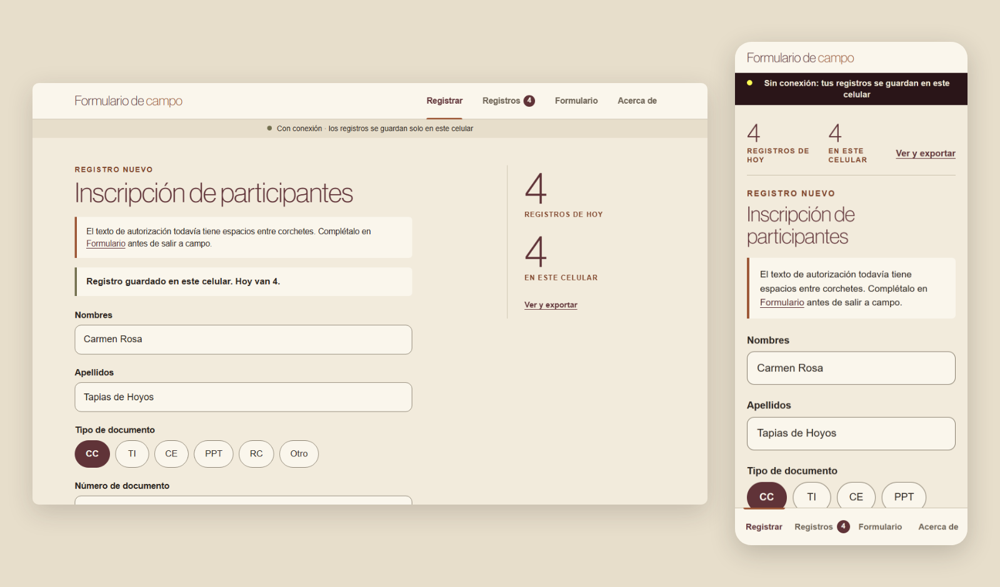

# Formulario de campo · Colombia

[Español](#español) · [English](#english)

## Español

Un formulario gratis y abierto que funciona sin internet: se abre una vez con señal, se agrega a la pantalla de inicio del celular y después guarda los registros en el mismo celular y los exporta a Excel. Es para equipos de cooperación, ONG, fundaciones, universidades y proyectos que inscriben participantes en veredas y barrios donde no hay señal.

**Ábrelo aquí:** https://estado-x.github.io/formulario-de-campo-colombia/

### Qué hace

- **Funciona sin conexión** después de la primera visita, y se puede instalar en la pantalla de inicio en Android y en iPhone. Una franja siempre visible dice si hay conexión o no.
- Trae la plantilla **«Inscripción de participantes»**: nombres, apellidos, tipo y número de documento (CC, TI, CE, PPT, RC u otro), fecha de nacimiento, sexo, municipio, vereda o barrio, teléfono y la casilla obligatoria de autorización de tratamiento de datos, con un texto modelo que cita la Ley 1581 de 2012.
- **Sugiere los municipios** de Colombia mientras escribes (lista DIVIPOLA del DANE) y al exportar agrega el departamento y el código.
- **Revisa lo que se escribe:** documento solo con números según el tipo, fechas que existen (dd/mm/aaaa), teléfono de 10 números (celular, o fijo con indicativo 60X), datos obligatorios, y avisa si ese documento ya está registrado en el celular.
- **Editor del formulario:** agrega, quita, ordena y renombra campos (texto, número, fecha, una opción de varias, sí o no) y marca los obligatorios. La definición se **exporta e importa como archivo JSON**, para que todo el equipo use el mismo formulario.
- **Lista de registros** por día, con conteo; cada registro se puede corregir o borrar.
- **Exporta a Excel (.xlsx) y a CSV**, con la fecha en el nombre del archivo. Después de exportar ofrece borrar los registros del celular, con confirmación.

### Cómo funciona

Es una página estática: HTML, CSS y JavaScript sin dependencias, sin servidor, sin claves y sin rastreadores. No pide nada a internet mientras se usa.

1. `sw.js` (un *service worker*) guarda la página y sus archivos en el celular la primera vez que se abre con internet. Desde ahí se sirve aunque no haya señal. `manifest.webmanifest` permite instalarla.
2. Los registros y la definición del formulario se guardan en IndexedDB, la base de datos del propio navegador (`assets/almacen.js`). Nada sale del celular.
3. `assets/nucleo.js` tiene la plantilla, las validaciones y la tabla que se exporta; `assets/app.js`, la pantalla.
4. El Excel se arma en el navegador con `assets/excel.js` y `assets/zip.js`. Las celdas que empiezan por `=`, `+`, `-` o `@` se guardan como texto literal, para que ninguna hoja de cálculo las tome como fórmula.

Columnas del archivo, con la plantilla original: Nombres, Apellidos, Tipo de documento, Número de documento, Fecha de nacimiento, Sexo, Municipio, Departamento, Código DIVIPOLA, Vereda o barrio, Teléfono, Autorización de datos, Fecha del registro, Hora del registro, Id del registro. Sirven tal cual para pasar el archivo por una herramienta que quita duplicados.

### Úsalo o adáptalo

- **Para usarlo:** abre el enlace con internet, espera a que diga «Lista para usar sin conexión» y agrégalo a la pantalla de inicio (en Android, menú ⋮ → *Agregar a la pantalla principal*; en iPhone, Safari → *Compartir* → *Agregar a inicio*). Antes de salir, pruébalo en modo avión.
- **Para adaptarlo:** copia el repo (*Fork*) y activa GitHub Pages desde la rama `main`, carpeta raíz. Todas las rutas son relativas: funciona igual en una subcarpeta.
  - La plantilla y el texto de autorización están en `assets/nucleo.js` (`plantilla()` y `TEXTO_AUTORIZACION`).
  - Si cambias cualquier archivo, sube el número de `VERSION` en `sw.js`: así los celulares que ya la tienen descargan la versión nueva y la página ofrece «Actualizar».
  - Para actualizar los municipios: `python scripts/municipios.py`.
- **Para probarlo en tu computador:** `python -m http.server` en la carpeta del repo y abre `http://localhost:8000/`. Las pruebas de punta a punta corren con `pip install playwright openpyxl`, `playwright install chromium` y `python pruebas/probar.py`.

### Límites

- No sincroniza entre celulares, no envía los datos a ningún lado y no hace copias de seguridad. Cada celular guarda lo suyo y alguien junta los archivos al final.
- Los registros se quedan en el celular hasta que los exportes. Si pierdes el celular, lo cambias o borras los datos del navegador sin exportar, se pierden. Exporta y borra al final de cada jornada.
- En iPhone hay que abrirlo siempre desde el ícono de la pantalla de inicio: lo que se guarda desde el ícono y lo que se guarda desde Safari van por separado, y Safari puede borrar los datos de una página que lleva días sin abrirse.
- No reemplaza una plataforma de encuestas para miles de registros: no tiene saltos entre preguntas, fotos, firmas ni ubicación.
- Las validaciones son de forma: no comprueban que un documento exista ni que pertenezca a la persona.
- El CSV va separado por comas; si tu Excel lo abre en una sola columna, usa el archivo .xlsx.
- **Dónde entra tu criterio:** el formulario y el texto de autorización los defines y validas tú, o tu organización, antes de salir a campo. El texto que trae es un modelo, no una asesoría jurídica: completa lo que está entre corchetes, pide solo los datos que necesitas y, si inscribes niños, niñas o adolescentes o recoges datos sensibles, revísalo con quien lleve lo jurídico. Quien recoge los datos es responsable de cuidarlos.

### Crédito

- Inspirado en [SurveyJS](https://github.com/surveyjs/survey-library) (biblioteca de formularios, licencia MIT); no reutiliza su código. Está escrito desde cero.
- El escritor de Excel (`assets/excel.js` y `assets/zip.js`) viene de [Estado-X/facturas-colombia](https://github.com/Estado-X/facturas-colombia) (licencia MIT), adaptado a una sola hoja.
- Municipios: «DIVIPOLA- Códigos municipios», del Departamento Administrativo Nacional de Estadística (DANE), publicada en [Datos Abiertos Colombia](https://www.datos.gov.co/d/gdxc-w37w) con licencia [CC BY-SA 4.0](https://creativecommons.org/licenses/by-sa/4.0/deed.es). Corte del DANE: 30 de diciembre de 2024; consultada el 17/11/2026. `data/municipios.json` es una adaptación (nombres con mayúscula inicial; solo código, municipio y departamento) y conserva esa misma licencia CC BY-SA 4.0.

### Hecho por Estado X

Licencia MIT para el código (los datos de municipios, CC BY-SA 4.0, como se indica arriba). Esta herramienta es una muestra de lo que montamos en Consultorio X de Estado X para el recorrido completo de los datos de un proyecto. Para hablar de tu caso, escríbele a Juan Camilo Pérez Cuervo en LinkedIn: https://www.linkedin.com/in/juanperezcuervo/

## English

A free, open form that works offline: open it once with a connection, add it to your phone's home screen, and from then on it stores records on the phone itself and exports them to Excel. Built for cooperation teams, NGOs, foundations, universities and projects that register participants in places with no signal.

**Open it here:** https://estado-x.github.io/formulario-de-campo-colombia/

- **What it does:** works offline after the first visit and installs on Android and iPhone; ships a "participant registration" template (names, Colombian ID types and number, date of birth, sex, municipality, village or neighborhood, phone, and a mandatory data-processing consent box with a model text citing Colombia's Law 1581 of 2012); autocompletes Colombian municipalities; validates entries; lets you edit the form (add, remove, reorder, rename fields; five field types; required flags) and export/import its definition as JSON so a whole team shares one form; lists the day's records with a count; exports to .xlsx and CSV with a dated file name and then offers to delete the records from the phone.
- **How it works:** a static page with no dependencies, server, keys or trackers. A service worker (`sw.js`) caches the page; records live in the browser's IndexedDB; the .xlsx is built in the browser. Cells starting with `=`, `+`, `-` or `@` are written as literal text to prevent formula injection.
- **Use or adapt it:** fork the repo and enable GitHub Pages from the `main` branch. All paths are relative. Bump `VERSION` in `sw.js` whenever you change a file. Tests: `python pruebas/probar.py` (Playwright + openpyxl).
- **Limits:** no sync between phones, no uploads, no backups. Records stay on the phone until you export them; lose the phone before exporting and they are gone. On iPhone, always open it from the home-screen icon. It does not replace a survey platform for thousands of records, and it cannot verify that an ID is real. The form and the consent text are yours to define and validate before fieldwork; the bundled text is a model, not legal advice.
- **Credit:** inspired by [SurveyJS](https://github.com/surveyjs/survey-library) (form library, MIT license); it does not reuse its code. Excel writer from [Estado-X/facturas-colombia](https://github.com/Estado-X/facturas-colombia) (MIT). Municipalities: DIVIPOLA by DANE via [datos.gov.co](https://www.datos.gov.co/d/gdxc-w37w), CC BY-SA 4.0 (DANE cut-off 30 Dec 2024, retrieved 17 Nov 2026); `data/municipios.json` is an adaptation under the same license.

Made by Estado X · MIT license (code).
